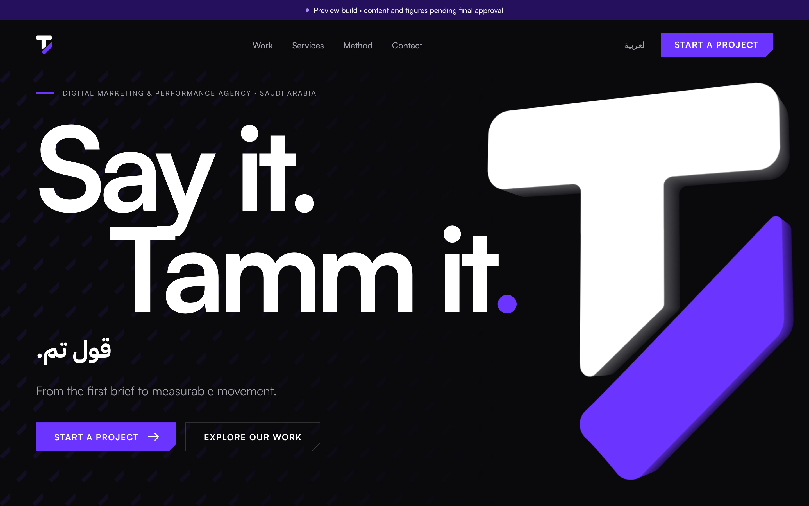

# SayTamm Website (v0.1 preview)

Official bilingual website for SayTamm (قول تم). Built with Astro 7 as a static site. JavaScript is under 4 KB per page, and the only dependencies are `astro` and `@fontsource/ibm-plex-sans-arabic`.



## Run it

```bash
cd site
```

```bash
npm install
```

```bash
npm run dev
```

`npm run build` writes the static site to `dist/`, and `npm run preview` serves it. Both `dev` and `build` first run `scripts/fetch-satoshi.mjs` (see Fonts).

## Routes

| EN | AR | Page |
|---|---|---|
| `/en/` | `/ar/` | Home: hero, credibility, philosophy, what we do, selected work, performance, method, final CTA |
| `/en/services/` | `/ar/services/` | 4 pillars, 9 services (D-003 / P-010) |
| `/en/work/` | `/ar/work/` | Team track record, full case studies (D-009) |
| `/en/contact/` | `/ar/contact/` | Business inquiry form |
| `/` | | Redirects to `/en/` (to be replaced by a 301 at the host) |
| `/404.html`, `/sitemap.xml`, `/robots.txt` | | |

## Structure

```
src/
  config/site.ts        Verified business facts only (unknowns are null → nothing invented). `preview` flag.
  i18n/ui.ts            All interface copy, EN + AR (Arabic composed natively; native review pending, OQ-25)
  i18n/paths.ts         Locale-prefixed routing helpers
  data/services.ts      9 services in 4 pillars
  data/cases.ts         Case figures from source documents only, each with period and market
  lib/logo.ts           Reads the approved symbol's two paths verbatim from assets/logo/symbol.svg
  styles/tokens.css     Design tokens: colour, type, space, grid, shape, motion
  styles/global.css     Base, layout, buttons, reveal system, reduced-motion
  components/           Logo, Sculpture, Pattern, SectionHead, PageHero, CaseVisual, CaseStudy, ContactForm, Header, Footer
  components/home/      Homepage sections
  layouts/Base.astro    <html lang dir>, SEO (canonical, hreflang, OG, JSON-LD), reveal + analytics scripts
  pages/[lang]/…        One page file per route, rendered for both locales
```

## Design system: rules that must not drift

- **Logo.** Only `components/Logo.astro`, which uses the exact approved paths (D-011). The header shows the **symbol only**, with no text lockup, until the drawn "SayTamm" wordmark exists (D-008, OQ-05). The symbol is never mirrored in RTL, never semi-transparent, never recoloured outside its variants.
- **Hero sculpture** (`Sculpture.astro`): the exact silhouette extruded in CSS 3D by stacking the same two paths. The face is flat, with no gradient; the side walls are depth tints of palette colours. **Never animate `opacity` inside its 3D context**, because Chromium flattens the extrusion; fade the outer `.sculpture` instead.
- **Pattern** (`Pattern.astro`): the diagonal element **only**, never the full logo. One colour and one size per instance, 8–18% opacity behind content.
- **Colour:** approved palette only (`tokens.css`). On dark backgrounds, purple **text** under 24 px uses `--accent-text` (Purple 200). Electric Purple text on Obsidian is only 3.38:1.
- **Arabic:** no letter-spacing, no uppercase, its own line-heights, logical CSS properties everywhere. Numbers and units with ×, $ or % use `.latin` so bidi doesn't reorder them.
- **Motion:** expo-out, purposeful, nothing loops, and `prefers-reduced-motion` is fully honoured. Reveals use a rAF position check, not IntersectionObserver, because IO ignores elements whose own clip-path hides them.
- **Content:** no invented clients, results or testimonials. Missing assets render as clearly labelled `.placeholder-tag` elements.

## Fonts

- **Satoshi** (ITF Free Font License): self-hosting on our own site is permitted. Files are used **unmodified** (no subsetting or conversion) and **must not be committed** to the repository, which the licence treats as redistribution. They are downloaded from Fontshare at build time into `public/fonts/satoshi/` (gitignored).
- **IBM Plex Sans Arabic** (SIL OFL): bundled through `@fontsource`.

## Analytics readiness

Elements with `data-track="event"` push to `window.dataLayer`. Events: `cta_click`, `language_switch`, `email_click`, `case_study_view`, `form_start`, `form_error`, `form_submit`. No tags load yet: GTM and consent mode are to be added before launch (PDPL).

## Before launch (not done, needs owner decisions)

- [ ] Form endpoint + CRM (OQ-19). Until then the form opens a pre-filled email to info@saytamm.com and says so.
- [ ] Drawn wordmark → header and footer lockups (OQ-05)
- [ ] Original case data exports and campaign visuals (OQ-32)
- [ ] Native Arabic copy review (OQ-25)
- [ ] Hosting (OQ-21), 301 from `/` and apex → `https://www.saytamm.com/en/`, email DNS (SPF/DKIM/DMARC)
- [ ] Set `preview: false` in `site.ts`, switch `robots.txt` to allow, add GTM + consent banner, legal footer details (OQ-09)
- [ ] **No DNS change or production deploy without explicit owner authorisation**

## QA performed (2026-11-04)

- **Build:** 11 routes; 260 internal links and anchors resolve.
- **Layout and errors:** 8 pages × 3 viewports (390 / 820 / 1440), EN + AR, with no horizontal overflow and no console errors.
- **Functional tests (19):**
  - Form: validation, focus management, `?service=` preselect, dataLayer events.
  - Mobile menu: open, Escape, close button reachable.
  - Language switch keeps the page; `lang` / `dir` correct.
  - Skip link is the first Tab stop.
  - Reduced-motion and no-JS both show all content.
  - Metadata: canonical, hreflang ×3, noindex while in preview, JSON-LD.
- **Performance (local, mobile):** LCP ≈ 0.12 s, CLS 0, HTML 14 KB, CSS 16 KB, JS ≈ 3.5 KB.
